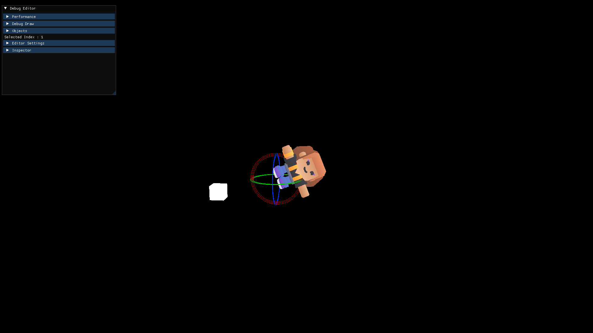

# DirectXGame

DirectX11を使用して作成している C++ のゲームプロジェクトです。

## 概要
DirectX11を用いた描画処理の学習と、就職作品としての開発を目的に制作しています。  
現在はOBJモデルの読み込み機能に加え、MTLファイルとテクスチャの読み込みまで対応し、  
3Dモデルの描画処理の流れを一通り実装しています。

---

## 現在の実装内容

├ 描画
├ モデル / Material
├ Scene
├ Input
├ Time
├ Debug / Editor
│ ├ Inspector
│ ├ Object Selection
│ ├ Ray Picking
│ ├ Bounds (AABB / OBB)
│ ├ Move Gizmo
│ ├ Rotate Gizmo
│ ├ World / Local Gizmo
│ ├ Free Camera
│ └ Focus Selected Object
├ GameObject / Transform
└ Window Resize

### エディタと素材管理(Unity風)
- パネルのドッキング(Hierarchy / Inspector / Assets / Log など。配置は自動で保存)と、上部の **Editor メニュー**(パネルの表示、レイアウトの初期化、ヒントのON/OFF、機能のON/OFF、ショートカット一覧)
- ウィンドウにカーソルを置くと、使えるキーが小さく出るヒント
- **Assets**(F2): フォルダの木とサムネイルの一覧。実行中にフォルダの作成・名前の変更・移動
- **Asset Viewer**: 選んだフォルダ・モデルを一括で読み込んで、並べて確認(時間分割の読み込み)
- モデルのキャッシュ(一度読んだら、次回から約12倍速)
- Assetsからゲームの画面へドラッグ&ドロップで飾りを置く(セーブ対応)、エクスプローラーからのドロップで素材を取り込む

使い方の全て: [docs/guide/asset_browser_guide.md](docs/guide/asset_browser_guide.md) / 設計: [docs/design/asset_browser.md](docs/design/asset_browser.md) / 学習メモ: [docs/study/](docs/study/)

## 使用技術
- C++
- DirectX11
- HLSL
- Dear ImGui
- Visual Studio
- Git / GitHub

## 実行方法
1. Visual Studio で `GAME.sln` を開く
2. ビルド構成を `Debug` または `Release` に設定
3. 実行する
## 実行結果

### Debug Editor

## 理解したこと

### ImGuiによるデバッグエディタ

Dear ImGuiを用いてゲーム実行中に内部状態を確認・編集できるデバッグエディタを実装しました。

現在は以下の機能に対応しています。

- FPS / DeltaTime表示
- VSync状態表示
- GameObject一覧表示
- 選択中ObjectのTransform編集
- Position / Rotation / Scale編集
- Scene上でのObject選択（Ray Picking）
- AABB / OBB表示
- Move Gizmoによる位置編集
- Rotate Gizmoによる回転編集
- World / Local Gizmo切り替え
- Free Camera
- Focus Selected Object (Fキー)

Move Gizmoではマウス移動量を軸方向へ投影する方式を採用し、任意の軸方向への移動を実現しました。

Rotate Gizmoでは回転リングを表示し、リング平面上でのマウス操作による回転編集を実装しています。

また、Gizmoはカメラとの距離に応じてサイズを自動調整することで、画面上で一定の大きさに見えるようにしています。

DebugEditorはGameContext経由でRenderer、Camera、InputManager、TimeManager、GameObject一覧へアクセスする構造にし、依存関係の肥大化を防いでいます。

## 現在の課題

- Rotate Gizmoの改善
  - Quaternion対応
  - Unityライクな回転操作

- Scale Gizmo実装

- Undo / Redo

- Object生成 / 削除

- ステージエディタ作成

- ステージデータの保存 / 読み込み

- サウンドシステム

- リソース管理の整理

- ライティング

## 今後の実装予定

- Scale Gizmo
- Undo / Redo
- Object生成 / 削除
- Scene Hierarchy
- ステージエディタ
- JSON保存 / 読み込み
- ライティング
- サウンドシステム

## 制作意図
DirectX を用いたゲーム開発の基礎理解と、設計・描画・管理の流れを段階的に学ぶために制作しています。  
機能を一つずつ実装しながら、ゲームとして完成度を高めていく予定です。

## 素材・ライブラリのライセンス
使用している3Dモデル(Kenney など)とライブラリ(Dear ImGui など)の出所・ライセンス・クレジットは [THIRD_PARTY_LICENSES.md](THIRD_PARTY_LICENSES.md) にまとめています。
